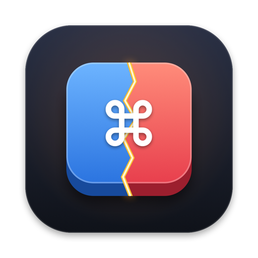

# Keyclash

Use the keyboard more and the mouse less. Keyclash shows every keyboard shortcut on your Mac, finds the shortcuts that clash, and shows which shortcuts you use.

Site: [keyclash.app](https://keyclash.app). Its source is in [site/](site/).



## What it does

- **Settings.** Click **Settings…** in the header or press ⌘, to open a separate window. Appearance, Peek, use counting, and local data controls apply immediately. ⌘W or Escape closes Settings and preserves your selected tab.
- **Conflicts.** Lists each clash between two system-wide hotkeys, and each system-wide hotkey that blocks a menu item of an app. Each row has a link to the place where you change the keys, and a list of free keys.
- **Keyboard map.** Hold or click modifier keys. Each key shows if it is free, used, shared, blocked, or in a clash. The "Use" colors show how many times you press each key.
- **Look up keys.** Type or record a key combination to see each app that uses it. A word that is not a key gives a warning, not a guess. The verdict line lists the same key with other modifier keys ("Also used") and free keys with the same modifier keys. Click a key to look it up.
- **All shortcuts.** One table of every shortcut. Click a column heading to sort; click it again to reverse the order. "Works" filters system-wide, in-app, and mode keys. "Only my apps" keeps open apps and apps with presses in 30 days. Export saves the rows as Markdown or CSV in Downloads.
- **By app.** Open apps come first. Sort by name, shortcut count, or use. The pane shows the app's shortcuts grouped like Peek, with mode keys in their own group, a filter, press counts, and "Open in Peek".
- **Lists.** In Look up keys and All shortcuts, click a row to select it, use ↑ and ↓, and press Return to show its app in By app. Right-click a row, or use the line under the list, to star, hide in Peek, copy the keys, or look them up. Click an app name to open it in By app. ⌘F goes to the search field of the tab. ⌘ + and ⌘ − change the text size of the lists and Peek.
- **Use.** Counts shortcut presses per foreground app and day. Shows unique shortcut matches, ambiguous presses, starred shortcuts without a unique match, and keys absent from the scan. A key observation does not prove an action ran. The counter is off until you turn it on.
- **Agent tools.** Export a JSON inventory or connect an agent with `--mcp`. Propose shortcut changes with a diff, apply an approved plan with a backup, and undo it. See the [agent guide](docs/AGENT-GUIDE.md) for setup and supported writers.
- **Peek.** Press Command two times in any app to see the shortcuts of that app, with its icon.
  - A quick double press gives Peek the keyboard: type to filter, use the arrow keys, press Return to run the shortcut, and press Option-Return to star it. Esc clears the filter, then closes Peek.
  - Hold the second press to see Peek only while you hold. Add Shift, Option, or Control to highlight the shortcuts that use those keys. The "Free with" line shows the letters that no shortcut uses with the held keys.
  - Each row shows a "⚠ tool" mark when a system-wide hotkey of another tool takes its keys, and how many times you pressed it in 30 days (with the use counter on).
  - Right-click a row to run, star, or hide it. "Also active here" lists the system-wide hotkeys of other open tools. "Keep open" keeps Peek on screen while you work; it then follows the app in front.
  - Drag the top of Peek to move it, also to another screen. Drag the corner grip to resize it. Peek opens there next time. Double-click the top to put it back in the middle.
  - If you disconnect a display, Peek fits its saved window onto a connected screen. It also fits windows that are larger than the current screen.
  - ⌘ + and ⌘ − change the text size. Settings › Peek has the key, the highlight mode, and the text size.

## Install

Keyclash is signed with an Apple Developer ID and notarized by Apple.

1. Download `Keyclash.zip` from the [latest release](https://github.com/hitpoint-hi/keyclash/releases/latest), unzip it, and move **Keyclash** to your Applications folder.
2. Open Keyclash. Read the welcome page and click **Start**.
3. Click **Ask macOS for permission** and turn on Keyclash in the Accessibility list. Without this permission, Keyclash still shows the shortcuts that it finds in files.
4. Optional: macOS guards the settings of sandboxed apps (for example macshot and Maccy). To see their hotkeys, turn on Keyclash in System Settings › Privacy & Security › Full Disk Access, then click **Scan again**. The "Where we looked" tab tells you when macOS blocked these files.

Keyclash runs on Apple Silicon and Intel Macs. It was tested on one Mac only (Apple Silicon, macOS 27), so tell me what looks wrong on yours.

## Updates

Keyclash checks GitHub on startup and once a day while the app is open. When a new version is available, **View release** opens its download page. **Dismiss** hides the notice for that version. You can check manually or turn off automatic checks under **Settings → Updates**.

To install an update, quit Keyclash and replace it in Applications with the copy from the new ZIP. If you upgrade from 0.1.0, macOS may ask for Accessibility permission again because the app signature changed.

## Where the shortcuts come from

- macOS keyboard shortcut settings and defaults
- App settings files (plist and JSON), also of sandboxed apps
- Config files of AeroSpace, OmniWM, skhd, Karabiner-Elements and Wispr Flow
- Menu files inside app bundles, and the code of Electron apps
- Live menus of open apps, read through the Accessibility permission

The "Where we looked" tab shows the count from each source.

## Privacy

- Shortcut scans, counts, and backups stay on this Mac. Update checks request public release information from GitHub without sending your shortcut data.
- When you connect an external agent, that client receives the tool results. Its provider and privacy settings control further transmission.
- The key listener reads each key press and gives it back unchanged.
- It also sees that a mouse button went down, so a ⌘-click does not open Peek. It does not read where you click or which button. It does not count or store clicks.
- The use counter is off until you turn it on. It counts only key presses with ⌘, ⌃, ⌥ or 🌐. It does not record what you type.

Keyclash keeps its data in `~/Library/Application Support/Keyclash/`:

| File | Content |
|---|---|
| `settings.json` | The panel key, the use counter choice, and that you read the welcome page |
| `usage.json` | Press counts per day, app and key combination. No typed text. |
| `favorites.json` | Starred shortcuts |
| `menus.json` | Menus read from apps on earlier scans |
| `menus.lock` | Coordinates concurrent menu-cache updates |
| `hotkey.log` | Short log of the key listener |
| `agent/` | Remapping proposals, recovery history, and config backups. These can contain config commands. |

## Build and run

Keyclash is a Rust app (egui / eframe) for macOS.

```sh
cargo run                                   # open the window
cargo test                                  # run the unit tests
cargo run -- --report                       # print the clashes, no window
cargo run -- --report --dump                # print each shortcut as a tab-separated row
cargo run -- --report --json                # JSON inventory, conflicts, source status, and free keys
cargo run -- --tool help                    # list the ten agent tools and their arguments
cargo run -- --mcp                          # local MCP server over stdin/stdout
cargo run -- --install                      # make ~/Applications/Keyclash.app and open it
cargo run -- --bundle dist                  # make dist/Keyclash.app, for a download
cargo run -- --screenshot shots/now.png     # draw the window to a PNG and exit
cargo run -- --screenshot x.png --tab lookup --lookup "cmd shfit t"   # a tab, with lookup text
cargo run -- --screenshot x.png --tab apps --app bobko.aerospace        # By app with one app selected
```

Only the installed app counts key presses.

After building, run `python3 scripts/check-agent.py target/debug/keyclash` to check the CLI
and the MCP propose/apply/undo flow. This check reads installed shortcut sources but writes
only a disposable skhd config and a separate Keyclash data folder.

For isolated QA, set `KEYCLASH_DATA_DIR` to a temporary directory before starting the app.
Settings, favorites, counts, menus, and logs then use that directory. Migration from the normal profile is disabled.
Earlier menu records without an app identity remain stored but need a new live read before reuse.

For design work, read [PRODUCT.md](PRODUCT.md), [DESIGN.md](DESIGN.md), and [Impeccable setup](.impeccable/README.md).
Run `scripts/setup-design.sh` to link the shared skill and repair the Codex hooks.

## More

- [IDEAS.md](IDEAS.md): the backlog
- [assets/make_icon.swift](assets/make_icon.swift): the script that draws the icon

## License

Keyclash is released under the [MIT License](LICENSE).
